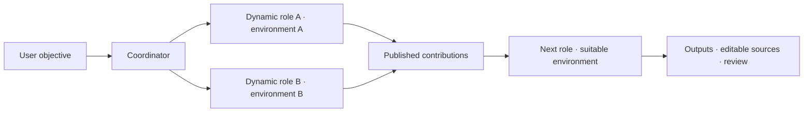

# RigHaven

RigHaven is a home and an on-demand toolbox for AI agents. Describe an objective;
the coordinator composes project-specific roles, selects useful skills and CLI
tools, and follows the work through execution, review and delivery.

A project can use **several environments, including in parallel**. Each assignment
gets an isolated working area; other roles consume deliberately published
contributions. Prepared software can be reused without sharing private project
files or reusing a previous assignment's writable workspace.

The managed catalog contains **62 tools** for documents, graphics, audio/video,
CAD, diagrams, data analysis, PDF/OCR checks, GIS, software testing, security,
simulation, electronics and print preparation. Skills describe methods and tool
expertise; environments combine software capabilities; roles are composed for
the objective. See [optional environments](docs/OPTIONAL-ENVIRONMENTS.md).

## Getting started

1. Open your RigHaven installation and sign in. Use **Create account** when the
   administrator has enabled registration. The initial setup creates the first
   administrator; later registrations create ordinary users.
2. In Community installations, the administrator connects the AI providers under
   **Models & resources**. OpenAI Codex, Antigravity CLI, Claude Code CLI, DeepSeek and custom
   OpenAI-compatible endpoints are supported. Choose models for the coordinator,
   the executing team or both. Ordinary users use the configured shared service.
3. Select **New task**. Describe the result, audience, delivery format, references
   and constraints. Answer the coordinator's material clarification questions.
   You do not have to create a team or preload an environment first: authorized
   capabilities can be prepared on demand.
4. Follow **Tasks & results** for decisions, assignments, progress, revisions and
   files. Independent assignments can run in different environments within the
   configured CPU/RAM and concurrency limits; dependent work waits for its inputs.
5. Open the delivered files and editable sources, review the instructions and
   remaining checks, then accept the result or request a focused revision.
   A technically valid file is not automatically an approved final product.

### Prepare an environment for recurring work

Open **Environments**, choose a preset or create a custom configuration, describe
its purpose, and select the relevant skills. Keep occasional tools **on demand**,
or preload selected programs for repeated use. Preparation runs native workflow
checks before reporting programs ready.

You can edit or clone a configuration and select verified program versions,
including `latest` for the compatible stable release. A new version may require a
new software variant; preparation details explain the trigger and observed change.
The terminal is a disposable inspection session: shell edits do not automatically
update the prepared image or its reproducible recipe.

An illustrative project:



## Run the Community edition

Requirements: Docker Compose and a platform that supports the privileged internal
runtime container. The application does not mount the host Docker socket.

```sh
git clone https://github.com/ggmm82/righaven.git
cd righaven
cp .env.example .env
```

Set a unique `RIGHAVEN_PASSWORD` of at least 16 characters in `.env`, then start:

```sh
bash righaven.sh up
```

Open http://localhost:2026. The local Caddy proxy first asks for `RIGHAVEN_USER`
and `RIGHAVEN_PASSWORD`; create or sign in to your personal RigHaven account after
that gate. These proxy credentials do not create an application administrator.

For Hostinger, use the **sealed Compose attached to a successful verified release**.
That deployment routes to the native account login through Traefik. Keep the same
installation and persistent data when replacing containers. See
[data across releases](docs/PERSISTENT-DATA.md).

## Personal work and shared infrastructure

| Personal to each account | Shared within the installation |
|---|---|
| Chats, project files and outputs | Prepared software images and cache |
| Native team profiles, skill selections and environment preferences | Server CPU/RAM and execution capacity |
| Project experience and accepted reusable lessons | Community provider connections managed by the administrator |
| Private configurations before explicit publication | Instance Gallery and approved remote catalogs |

Administrators manage accounts, shared connections, default program versions,
capacity and trusted software-image imports. Users can manage their own tasks
and environments, export configuration or prepared software, and propose reusable
Gallery content. Software-image import and registry administration require an
administrator. Software reuse does not publish another user's files or lessons.

## Account administration, instructions and reset

Administrators use **User administration** to create accounts with a temporary
password, assign configured roles, suspend or reactivate access, reset passwords,
and revoke existing login sessions. The last active administrator is protected.
Changing SSO passwords remains the identity provider's responsibility.

**Tools & skills → select a skill → Full instructions** shows the actual Markdown
and reference files. Saving validates and scans the content and creates a
personal copy, retaining references and the enabled/disabled state. Other users'
instructions remain unchanged. New assignments load the copy without reinstalling
software. Write purpose, procedure, editable deliverables and observable checks;
do not put credentials in skill text. Restore shipped instructions through
**Maintenance & reset**.

**Environments → Manage** separates **Programs & versions** from **Skills &
instructions**. Installed versions come from the prepared software manifest;
requested versions and available updates are shown separately. Older images may
need **Detect installed versions**, which reads their manifest without installing
software. A skill is an instruction package, not an installed program. The
advanced native profile editor edits the same environment configurations; it is
not another team. Project roles remain dynamic.

**Maintenance & reset** lets you select one item or a category: conversations and
project files, environment profiles, personal skill overrides, or version choices.
Administrators can also reset shared model assignments and global version choices.
A preview lists affected items and requires its exact typed confirmation. Tokens
expire after ten minutes and are single-use; changed targets require a new
preview. Active work must finish first. Accounts, provider credentials and shared
software images are retained. Export project files before deleting conversations.

## Data engineering

Choose **Environments → Examples → Data Engineering**, or activate **Data
Engineering Rig** from the Gallery. Prepare only the tools needed for the task:

| Need | Capability |
| --- | --- |
| Multi-database queries | usql; private, authorized read-only connections |
| Reverse engineering | SchemaCrawler JDBC metadata; declared keys and constraints |
| Extraction and discovery | dlt with SQLAlchemy/MongoDB; bounded snapshots and reconciliation |
| SQL dialects and lineage | SQLGlot using actual SQL and optional observed schema |
| Tested transformations | SQLMesh in an isolated local DuckDB project |
| Python exploration | Jupyter notebooks and DuckDB |
| Interactive or paginated reports | Quarto HTML and Typst PDF, retaining editable sources |

See [data engineering guide](docs/DATA-ENGINEERING.md) for connection setup,
workflow, source delivery and verification limits. Driver availability does not
certify an untested remote connection; inferred relationships are hypotheses.

## Gallery and portability

Gallery packs describe reusable environments, tools and skills. Activating an
environment creates a native configuration with on-demand preparation; activating
a skill uses the native archive scanner. Disabled capabilities remain disabled.
Only tools supported by the managed runtime are installable automatically.

Environment configuration export, full software-image export and Gallery
publication are separate operations. A prepared-software package includes the
image, Dockerfile and rebuild recipe, without accounts or project data. Gallery
publication uses **Environments → Manage → Share to catalog**: enter English and
Italian metadata, inspect the actual purpose, instructions, skills and managed
tool choices, then explicitly confirm the preview. Nothing is published by saving
an environment. Published versions are immutable and publisher-owned; new entries
are unverified and become visible in this installation. Private custom skill files
must be packaged separately; local verified version IDs require software export
rather than pretending they are portable catalog references.

Search environments by purpose, name, skill or tool. Configuration history retains
up to 50 owner-scoped snapshots; restore revalidates the current capabilities and
version choices. Project files are unaffected. A `latest` choice follows today's
verified stable release, so restoring configuration is not an image rollback.

Gallery details include **1–5 star reviews, comments and publisher replies**.
Ratings belong to a published version, with one editable rating per account and
version; favorites are separate. Imported environments retain their catalog origin
and link directly to feedback for that version, even after a newer release appears. Experiences are self-reported, not certifications.
Review authors can delete their own content. Reports go to administrator moderation
and do not automatically hide a review. Public discussion uses pseudonyms instead
of exposing account IDs or email addresses.

Administrators can synchronize HTTPS catalogs pinned to an approved SHA-256.
A public global Hub, publisher signatures and reviewed onboarding of arbitrary
third-party CLI recipes remain under development. See the
[user journey review](docs/USER-JOURNEY-REVIEW.md) for remaining onboarding,
account onboarding, private skill packaging and public distribution work.

## Hosted preview and languages

Community and hosted deployments use the same account and execution engine.
`RIGHAVEN_EDITION=cloud` enables the hosted preview, with encrypted private
DeepSeek/OpenAI-compatible API profiles and account job limits. It does not yet
provide shared organizations, invitations, commercial plans or token billing.
The hosted private-connection flow does not currently match the Community
Codex/Antigravity login flow.

English is the default; Italian is available. Some operational and advanced
surfaces still need localization. See [workspace guide](docs/WORKSPACE.md),
[product status](docs/PRODUCT-STATUS.md) and [core boundary](docs/CORE-BOUNDARY.md).

## Development and verification

```sh
python scripts/validate.py
python -m unittest discover -s tests -v
```

CI also exercises the real Gateway, authentication, private ownership, native
skills, prepared environments, output fixtures, portability and container
replacement. A passing technical fixture does not certify artistic quality,
engineering safety or a complete public SaaS service.

RigHaven is [MIT licensed](LICENSE). Incorporated source notices are preserved in
[docs/UPSTREAM-LICENSE](docs/UPSTREAM-LICENSE).

---

## 👤 Author

**Marco Gramuglia**  
*Computer Engineer | Data Engineer | Analytics & AI | IT Service Management*

- 📍 Rome, Italy
- 💼 LinkedIn: [linkedin.com/in/marco-gramuglia-2686bb30](https://www.linkedin.com/in/marco-gramuglia-2686bb30)
- 🐙 GitHub: [@ggmm82](https://github.com/ggmm82)
