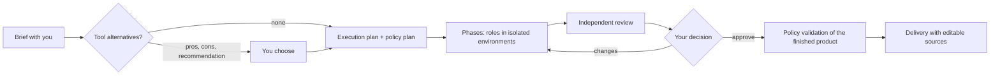

# RigHaven

RigHaven is a home and an on-demand toolbox for AI agents. You describe an objective; a
coordinator composes a team of roles for it, picks the skills and the tools they need (99
managed CLI tools, from documents and video to CAD, data and networks), runs each role in its own
isolated container and follows the work through review and delivery. **You decide at every step**:
tool alternatives come with their trade-offs, each phase waits for your reply, and the runtime,
not the model's goodwill, enforces your policies before anything is delivered.

[](docs/media/righaven-teaser.mp4)


https://github.com/user-attachments/assets/fadcbe54-a836-4a16-8b7e-45764ca20a6e


*15-second teaser ([MP4](docs/media/righaven-teaser.mp4)), produced by RigHaven
itself: an EffectCraft motion-graphics role and a SoundCraft sound role working
from the brief “a teaser explaining RigHaven's architecture”. It is promotional
material; the guarantees RigHaven actually enforces are described below.*

## What you can do with it

| You want to… | In RigHaven | Guide |
|---|---|---|
| Get a document, a presentation, a video, a model or an analysis from a brief | **New task**: the coordinator builds the team and delivers files with editable sources | [Workspace](docs/WORKSPACE.md) |
| Follow a proven path end to end | **Recipes**: phased projects (data pipeline, device monitoring, network assessment…) or your own | [Recipes](docs/RECIPES.md) |
| Work on databases | Connections to PostgreSQL, SQL Server/Azure SQL/Fabric (also with your Microsoft account and MFA), MySQL, Oracle; catalog, replica, synthetic data, pipelines | [Data engineering](docs/DATA-ENGINEERING.md) · [Connections](docs/CONNECTIONS.md) |
| Work with devices and IoT | MQTT, Modbus, HTTP, serial and USB boards, Bluetooth LE, Matter, Android TV, OBD-II; every write approved by you | [Devices and IoT](docs/IOT.md) |
| Map your network and check it | Inventory and map of the networks you declare; each vulnerability check only after your approval | [Network](docs/NETWORK.md) |
| Edit the project's files yourself | **Files → Open with**: JupyterLab, editors and a terminal on the same environment | [Integrated editors](docs/INTEGRATED-EDITORS.md) |
| Set rules the work must respect | **Policy Book**: policy sheets checked on the finished product | [Policy Book](docs/POLICY-BOOK.md) |
| Reuse and share environments | Environments, Gallery packs, export of configurations and prepared software | [Environments](docs/OPTIONAL-ENVIRONMENTS.md) |
| Use your PC, your phone or a dedicated machine from a server | RigHaven Agent, the Android app, on-premise environments | [below](#connect-your-pc-your-phone-and-your-machines) |

How tasks, recipes, teams, skills, environments, connections and policies fit together:
[Concepts](docs/CONCEPTS.md).

## Quick start

### 1. Install: choose one

| Where | What you need | Steps |
|---|---|---|
| **One Windows PC** | Windows 10/11 with WSL 2 (no Docker Desktop) | Download `RigHaven-<version>-windows-x64-portable.zip` from the [latest release](https://github.com/ggmm82/righaven/releases/latest), extract it to e.g. `C:\RigHaven`, double-click `RigHaven.exe`. The browser opens http://127.0.0.1:2026 · [details](docs/WINDOWS-PORTABLE.md) |
| **One Linux PC** | Docker Engine | Download `RigHaven-<version>-linux-x64-portable.tar.gz`, extract it and run `./righaven` · [details](docs/LINUX-PORTABLE.md) |
| **A server (VPS)** for you or a team | Docker Compose; on Hostinger, Traefik | Deploy the `compose.hostinger.yaml` attached to the release and open its HTTPS address · [data across releases](docs/PERSISTENT-DATA.md) |
| **From source** (development) | Docker Compose | See [Run from source](#run-from-source) |

The first start downloads the verified images (about 1 GB, once).

### 2. Sign in and connect a model

1. Create the first account: it becomes the **administrator**. Later accounts are ordinary users
   (if the administrator enables registration).
2. Open **Models & resources** and connect at least one provider: OpenAI Codex, Claude Code,
   Antigravity or any OpenAI-compatible endpoint (OpenAI, DeepSeek, Kimi, OpenRouter…). Choose
   the model of the coordinator and of the team. See [model providers](docs/MODEL-PROVIDERS.md).

### 3. Your first task

1. Press **New task** and write what you want, for example:
   *"A two-page PDF report comparing the three CSV files I attach, with one chart per file;
   keep the editable sources."* Attach the files.
2. Answer the coordinator's questions and choose among the tool alternatives it proposes. There is
   no team to create and nothing to install first: the environment is prepared on demand.
3. Follow the **task card** above the chat: the goal, the progress, the decision waiting for you.
   Each phase shows its result and waits for your reply.
4. Open the delivered files and their sources, then accept or ask for a focused revision.

Next: try a **Recipe** (Recipes → *Use this recipe*), add a **Connection** to a database, or
change the language in **Account & preferences → Appearance**.

## Connect your PC, your phone and your machines

When RigHaven runs on a server, it cannot see your desk. Three small pieces bring it there; all of
them connect *to* the server, so no router port is opened:

| Piece | What it adds | Start |
|---|---|---|
| **RigHaven Agent** (Windows, Linux) | The PC's Bluetooth, Wi-Fi, COM ports and home network for the server; databases of the office network reached *through* the PC | **Connections → Connected PCs → Connect a PC**, then run `RigHaven-Agent-windows-x64.exe` and type address and code · [Agent](docs/AGENT.md) |
| **Android app** | The web interface on the phone, and the phone's Bluetooth LE, Wi-Fi and network as an agent | Install `RigHaven-android.apk` from the release and pair it with a code the same way · [Android](docs/ANDROID.md) |
| **On-premise environments** | Run an environment's tasks on a dedicated machine with Docker; coordination and data stay on the server, the environment's images stay on the machine | On the machine `RigHaven-Agent agent node on`, then **Environments → Configure → Where it runs** · [On-premise environments](docs/ON-PREMISE-ENVIRONMENTS.md) |

RigHaven can also be installed from the browser as an app, with a one-line task card on small
screens: [phones and the installable app](docs/MOBILE.md).

## How a project runs



- **Isolated roles.** Each assignment runs in its own container, with all capabilities dropped and
  resource limits; it reads the project read-only and writes only its own staging folder. Other
  roles see only what it deliberately publishes. Several environments can work in parallel within
  the configured CPU/RAM.
- **Environments on demand.** The software a task needs is installed into a reusable image, at
  the versions you choose; an environment can be kept ready for recurring work.
- **Your approvals.** Writes to devices and databases, vulnerability scans and phase results wait
  for you; an approved action runs once, exactly as approved.
- **Network egress.** With `RIGHAVEN_WORKER_EGRESS=allowlist` each job reaches only its model
  provider and the domains its role declares, and every blocked connection is reported.

## Personal work and shared infrastructure

| Personal to each account | Shared within the installation |
|---|---|
| Chats, project files and outputs | Prepared software images and cache |
| Environment profiles, skill selections and preferences | Server CPU/RAM and execution capacity |
| Project experience and accepted lessons | Provider connections managed by the administrator |
| Private configurations until you publish them | The instance Gallery and approved remote catalogs |

Administrators manage accounts (**User administration**), shared connections, default program
versions, capacity and software-image imports. **Maintenance & reset** removes selected
conversations, profiles or overrides after a typed confirmation. Details:
[Workspace guide](docs/WORKSPACE.md).

## Run from source

Requirements: Docker Compose and a platform that supports the privileged internal runtime
container (the application does not mount the host Docker socket).

```sh
git clone https://github.com/ggmm82/righaven.git
cd righaven
cp .env.example .env
```

Set a unique `RIGHAVEN_PASSWORD` of at least 16 characters in `.env`, then:

```sh
bash righaven.sh up
```

Open http://localhost:2026. The local proxy first asks for `RIGHAVEN_USER` and
`RIGHAVEN_PASSWORD` (a gate, not an application account); then create or sign in to your
RigHaven account.

## Documentation

| Document | Content |
|---|---|
| [Concepts](docs/CONCEPTS.md) | Task, recipe, team, skills, environments, connections, policies, deliveries |
| [Workspace guide](docs/WORKSPACE.md) | Using RigHaven step by step (English and Italian) |
| [Recipes](docs/RECIPES.md) · [Open chat](docs/OPEN_CHAT.md) | Guided projects and your own recipes; open-ended work with chosen resources |
| [Connections](docs/CONNECTIONS.md) | Databases, Microsoft sign-in with MFA, writing into a destination, cloud or on premise |
| [Data engineering](docs/DATA-ENGINEERING.md) | Data tools and the end-to-end pipeline recipe |
| [Devices and IoT](docs/IOT.md) · [Network](docs/NETWORK.md) | Device connections and toolkit; network inventory and approved checks |
| [Environments](docs/OPTIONAL-ENVIRONMENTS.md) · [Integrated editors](docs/INTEGRATED-EDITORS.md) | Tool catalog, preparation and reuse; JupyterLab and editors |
| [Policy Book](docs/POLICY-BOOK.md) | Policy sheets, enforced phases and checkpoints |
| [Model providers](docs/MODEL-PROVIDERS.md) | Codex, Claude Code, Antigravity, OpenAI-compatible APIs |
| [Windows](docs/WINDOWS-PORTABLE.md) · [Linux](docs/LINUX-PORTABLE.md) portable apps | One-PC installations, commands and limits |
| [RigHaven Agent](docs/AGENT.md) · [Android](docs/ANDROID.md) · [On-premise environments](docs/ON-PREMISE-ENVIRONMENTS.md) | Your PC, phone and machines for a server |
| [Data across releases](docs/PERSISTENT-DATA.md) | Upgrading while keeping the installation's data |
| [Product status](docs/PRODUCT-STATUS.md) · [Core boundary](docs/CORE-BOUNDARY.md) | What is complete, preview or planned |
| [C4 model](docs/c4/righaven.dsl) · [BPMN lifecycle](docs/bpmn/righaven_harness_lifecycle.svg) · [Technical report](docs/technical-report.typ) | Architecture (produced by a RigHaven project about its own repository, checked against the code) |

English is the default interface language; Italian is available.

## Development and verification

```sh
python scripts/validate.py
python -m unittest discover -s tests -v
```

CI also exercises the real Gateway, authentication, private ownership, native skills, prepared
environments, output fixtures, portability, container replacement, the agent, compute nodes and
the Android app. A passing technical fixture does not certify artistic quality, engineering safety
or a complete public SaaS service.

RigHaven is [MIT licensed](LICENSE). Incorporated source notices are preserved in
[docs/UPSTREAM-LICENSE](docs/UPSTREAM-LICENSE).

---

## 👤 Author

**Marco Gramuglia**  
*Computer Engineer | Data Engineer | Analytics & AI | IT Service Management*

- 📍 Rome, Italy
- 💼 LinkedIn: [linkedin.com/in/marco-gramuglia-2686bb30](https://www.linkedin.com/in/marco-gramuglia-2686bb30)
- 🐙 GitHub: [@ggmm82](https://github.com/ggmm82)

### Release versions

Stable releases use semantic tags such as `v0.8.0`. `VERSION` defines the minimum
product version; successive stable releases automatically advance the patch number.
A larger minor/major change can raise this minimum. PR candidates use
`v0.8.0-rc.pr.20.RUN.ATTEMPT`. Retrying the same stable commit keeps its version.
The Overview displays the product version; commit and build IDs are under Technical
details. The release Compose supplies the exact version through `RIGHAVEN_VERSION`,
including when the same verified images are promoted from preview to stable.

Release manifests retain the exact source commit and verified image digests: naming
a release does not rebuild the images already tested before merge.
