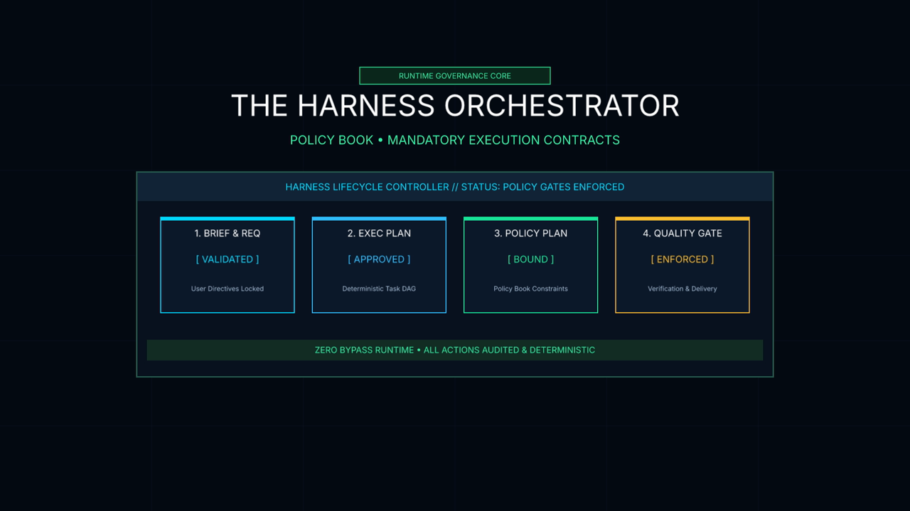
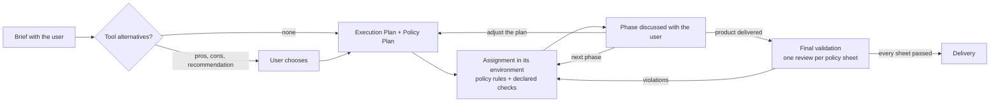

# RigHaven

RigHaven is a home and an on-demand toolbox for AI agents. Describe an objective;
the coordinator composes project-specific roles, selects useful skills and CLI
tools, and follows the work through execution, review and delivery. You decide at
every step: tool alternatives are proposed with their trade-offs, each phase is
discussed with you, and the runtime, not the model's goodwill, enforces the
organization's policies before anything is delivered.

[](docs/media/righaven-teaser.mp4)


https://github.com/user-attachments/assets/fadcbe54-a836-4a16-8b7e-45764ca20a6e


*15-second teaser ([MP4](docs/media/righaven-teaser.mp4)), produced by RigHaven
itself: an EffectCraft motion-graphics role and a SoundCraft sound role working
from the brief “a teaser explaining RigHaven's architecture”. It is promotional
material; the guarantees RigHaven actually enforces are described below.*

A project can use **several environments, including in parallel**. Each assignment
gets an isolated working area; other roles consume deliberately published
contributions. Prepared software can be reused without sharing private project
files or reusing a previous assignment's writable workspace.

The managed catalog contains **99 tools** for documents, graphics, audio/video,
CAD, diagrams, data analysis, PDF/OCR checks, GIS, software testing, security,
simulation, electronics and print preparation, plus lightweight command-line
tools for plain-text accounting, chemistry, bioinformatics, constraint solving
and symbolic math, climate data, file metadata and privacy, fonts, barcodes,
DevOps configuration linting, JSON/YAML/CSV data, email templates, ABC music
notation and offline proofreading. Skills describe methods and tool
expertise; environments combine software capabilities; roles are composed for
the objective. See [optional environments](docs/OPTIONAL-ENVIRONMENTS.md).

The first **recipe**, the end-to-end data pipeline, turns database documentation
into a described catalog, an empty local replica, periodic synthetic test data,
tested ingestion and transformations and a production package (Docker and
supercronic, for PostgreSQL, SQL Server or Microsoft Fabric); see
[Data Engineering](docs/DATA-ENGINEERING.md#recipe-end-to-end-data-pipeline).
Recipes are offered on demand from the **Recipes** page or proposed by the
coordinator when a request matches. Skills say *how* to work, environments *with
which tools*, and a recipe is the phased path that combines them: you can create
your own recipes or duplicate a built-in one from the Recipes page; see
[Recipes](docs/RECIPES.md). How project, recipe, team, skills, environments,
connections, policies and deliveries fit together: [Concepts](docs/CONCEPTS.md).

For open-ended work, see [Open chat: resources and shared methods](docs/OPEN_CHAT.md): select files, skills and optional connections, test an approach together, and review a reusable recipe before saving it.

## Edit project sources

Use **Files** in a conversation to browse project folders, search files and
choose **Open with** from the enabled editors. Editors open in a separate tab with
a collapsible file panel and a full-screen action. New sessions save directly to
the chat's project folder, with its referenced assets; no publication or copy-back
step is required. Existing private drafts remain recoverable.

JupyterLab provides notebooks, Python scripts/consoles and terminals on prepared
environments, including a writable persistent project Python environment. Native
editors mount the writable project and public chat folders. Browser editors load
on demand and retain normal downloads and file import interactions. Use
**Terminal** in an editor to work with its project files and environment.

Server editors use the same account-owned environment profiles, terminal,
configuration and transfer controls as the team. **When needed** uses the bounded
cache; **Keep ready** protects software separately from active CPU/RAM sessions.
See [Integrated editors](docs/INTEGRATED-EDITORS.md) for lifecycle, versions and
verified versus preview integrations.

## Getting started

1. Open your RigHaven installation and sign in. Use **Create account** when the
   administrator has enabled registration. The initial setup creates the first
   administrator; later registrations create ordinary users.
2. In Community installations, the administrator connects the AI providers under
   **Models & resources**. OpenAI Codex, Antigravity CLI, Claude Code CLI and any
   OpenAI-compatible endpoint (OpenAI, DeepSeek, Kimi, OpenRouter…) are supported; see
   [model providers](docs/MODEL-PROVIDERS.md) for what each one can do. Choose models for the coordinator,
   the executing team or both. Ordinary users use the configured shared service.
3. Select **New task** and describe the result, audience, delivery format, references
   and constraints, or start from a **Recipe**: write your goal, attach the schema or
   documents and tick the connections the task may use. Answer the coordinator's
   material clarification questions and choose among the tool alternatives it
   proposes. You do not have to create a team or preload an environment first:
   authorized capabilities can be prepared on demand.
4. Follow the task card above the chat: one header with the goal, progress, the
   decision waiting for you and the actions. In a free task the coordinator presents
   each phase's results and waits for your reply in the chat; in a recipe task each
   phase result is independently reviewed and then waits for **Approve phase**,
   **Request changes** or **Skip phase** in the card. Independent assignments can run
   in different environments within the configured CPU/RAM and concurrency limits;
   dependent work waits for its inputs.
5. Change the interface language in **Account & preferences → Appearance → Language**. The
   Overview footer shows which version is running (commit, origin and build time), so
   you can check a deployment at a glance.
6. Open the delivered files and editable sources, review the instructions and
   remaining checks, then accept the result or request a focused revision.
   A technically valid file is not automatically an approved final product.

## How a project runs



Every new project is governed by the organization **Policy Book**, and the
runtime enforces each step:

- **Brief.** Production waits until the intended result and delivery form are
  settled. When several catalog tools could produce it, the coordinator presents
  two to four alternatives with pros, cons and a motivated recommendation; only
  your reply records the choice, and roles cannot use the rejected programs.
- **Execution Plan and Policy Plan.** The coordinator pins the applicable policy
  sheets (mandatory ones are always added) beside the activities; production is
  refused until both exist.
- **Policy-aware assignments.** Each assignment receives the rules of its sheets
  and must declare the required checks in its handoff; a missing or failed
  blocking check sends the activity back to revision.
- **A pause after every phase.** When an assignment delivers a result, further
  production waits for your reply. The owner can turn pauses off per project. In a
  recipe task the phase approvals in the task card replace these chat pauses.
- **Final validation.** `harness_validate` checks delivery integrity, then runs an
  independent review per sheet, in parallel when sheets are independent, and
  aggregates every violation. Delivery is refused until all sheets pass.

Each conversation shows a **Policy** line with the phase, the sheets applied, the
verdict of each on the current product with its evidence, and the phase awaiting
your reply. Administrators define sheets under **Configuration → Policy Book**
through a guided setup that explains every option. See
[Policy Book](docs/POLICY-BOOK.md).

The coordinator records a capability rationale for each new role: why its tools
can create the requested content or editable model, not just export the final
format. The team view exposes this choice under **Why these tools**. Architecture
and process models can use C4/Structurizr or BPMN, then be integrated into a PDF;
simple informal diagrams can use a simpler method when it meets the brief.

### Prepare an environment for recurring work

Open **Environments → Add environment** to start from a Gallery pack, a starter
template, or a blank configuration. Describe its purpose and select its skills.
Gallery packs and templates are starting points, not already running machines. Keep occasional tools **on demand**,
or preload selected programs for repeated use. Preparation runs native workflow
checks before reporting programs ready.

You can edit or clone a configuration and select verified program versions,
including `latest` for the compatible stable release. A changed program creates an incremental software variant: compatible installed
programs are retained, and only missing or changed payloads are installed. Native
checks still run before the new variant is marked ready.
The page separates available profiles, configuration updates, first-use preparation,
and failed checks. Active temporary environments assembled for a chat appear
separately with their tools and a link to the assignment, even without a saved
profile. Model-provider CLIs are cached separately and mounted read-only for each worker.
Changing the coordinator/team model or CLI does not rebuild application
environments. Restarts and compatible releases reuse preserved software; cache
identity depends on the software platform and relevant installation inputs,
independently of skill text, worker code and unrelated catalog updates.

**Keep ready** profiles are the base of assignment environments. For each role
the runtime selects the prepared profile containing most of the role's skills,
then covering most of its programs, adopts that profile's versions and reuses its
image as is or extends it with only the missing programs. Each assignment card
states the profile used and why; the Environments page explains the criterion and
shows how many assignments each profile served. Prepared profiles stay allocated.

**Configuration → Machine usage** shows who used which machine, how and how much:
assignments, work and CPU hours and peak memory per machine, per user and per
role, with the latest assignments linked to their conversation. Administrators
see every user; everyone else sees their own.

The terminal is a disposable inspection session: shell edits do not automatically
update the prepared image or its reproducible recipe.

## Guided data projects

Choose **Recipes → Use this recipe** and describe the result in your own words.
Select **A working result first** for a usable result, editable sources and checks
with one approval, or **Follow every recipe phase** for the complete method. Saving
an owner decision resumes the team without a second confirmation. Existing tasks
can explicitly simplify their path while retaining files and prior decisions. In
the same intake you can attach the schema definition (DDL/SQL) and documents, add
links to external documentation and tick the registered connections the task may
use; nothing else is mandatory and no database connection is required for the
synthetic laboratory. The saved path shows catalog, design, laboratory, synthetic
data, pipeline, business reporting and deployable package. The task card above the
chat shows where you are; when a phase has been independently reviewed it waits for
you to approve it, request changes or skip it when it is not useful for your goal,
and the team proposes at the start the phases your goal does not need. The final
policy validation runs once, on the finished product. For Azure SQL and Fabric,
sign in with your own Microsoft account (multi-factor authentication included) from
[Connections](docs/CONNECTIONS.md#sql-server-with-your-microsoft-account); a
destination schema can receive the verified tables only when you allow writing for
the task. See [guided projects](docs/RECIPES.md) for actual scope and verification
boundaries.

## Run the Community edition

Requirements: Docker Compose and a platform that supports the privileged internal
runtime container. The application does not mount the host Docker socket.

```sh
git clone https://github.com/ggmm82/righaven.git
cd righaven
cp .env.example .env
```

Set a unique `RIGHAVEN_PASSWORD` of at least 16 characters in `.env`, then start:

```sh
bash righaven.sh up
```

Open http://localhost:2026. The local Caddy proxy first asks for `RIGHAVEN_USER`
and `RIGHAVEN_PASSWORD`; create or sign in to your personal RigHaven account after
that gate. These proxy credentials do not create an application administrator.

For Hostinger, use the **sealed Compose attached to a successful verified release**.
That deployment routes to the native account login through Traefik. Keep the same
installation and persistent data when replacing containers. See
[data across releases](docs/PERSISTENT-DATA.md).

### Windows portable app

Every verified release also carries `RigHaven-<version>-windows-x64-portable.zip`.
Extract it, double-click `RigHaven.exe` and the browser opens
http://127.0.0.1:2026: no Docker Desktop and no server. It runs the same verified
images in a dedicated WSL 2 distribution, so roles keep the same container isolation
as on the server; data stays in the `data` folder next to the executable. Details,
commands and limits: [Windows portable app](docs/WINDOWS-PORTABLE.md).

On Linux, `RigHaven-<version>-linux-x64-portable.tar.gz` does the same with the Docker
engine already on the PC: extract it and run `./righaven`
([Linux portable app](docs/LINUX-PORTABLE.md)).

### RigHaven on a VPS, your PC with RigHaven Agent

RigHaven also runs on a server (a VPS, from the release's `compose.hostinger.yaml`) with its
own web interface. `RigHaven-Agent-windows-x64.exe` is the small Windows program, with no WSL
and no Docker, that puts your PC's Bluetooth, Wi-Fi, COM ports and home network at the server's
disposal: pair it once with a code from **Connections**, and the server's searches, explorations
and device connections reach your devices through it. It is also the **on-premise connection
gateway**: a database of the office or home network (Postgres, SQL Server, MySQL, Oracle) is
*reached through* a PC of that network, while cloud databases go from the server. The PC
connects to the server, no router port is opened. See [RigHaven Agent](docs/AGENT.md).

**Android app.** The Android app (`RigHaven-android.apk`) shows the server's web interface and
runs RigHaven Agent on the phone: its Bluetooth LE, Wi-Fi and network at the server's disposal.
See [RigHaven for Android](docs/ANDROID.md).

**On-premise environments.** An environment can run its tasks on a dedicated machine of yours
(a Linux server or a Windows PC with Docker) while coordination and data stay on the server. See
[On-premise environments](docs/ON-PREMISE-ENVIRONMENTS.md).

**On the phone.** RigHaven can be installed as an app from the browser ("Add to Home
screen" or "Install app") and the project card collapses to one line, so the chat and
the team's questions stay visible: [phones and the installable app](docs/MOBILE.md).

**What the local mode is good for**

| Use case | Why locally |
|---|---|
| Documents and data that must not leave your PC | Files, generated outputs and the task history stay in the `data` folder; only model calls go to the provider you choose |
| Databases reachable only from your office network or VPN | Connections to `192.168.x.x` or `10.x.x.x` hosts work without exposing them to a server |
| Hardware on your desk | USB serial adapters and ESP/Arduino boards (via usbipd), an OBD-II adapter for your car, an Android TV on your Wi-Fi |
| Your home or office network | Inventory, network map and approved security checks of the network the PC is on |
| IoT prototypes and urban simulations | Scenarios, simulated telemetry and analysis on a laptop, before buying hardware or a server |
| Trying recipes and environments | Test a recipe, an environment or a new release before deploying it to the shared server |
| Demos and training | A complete RigHaven on one machine (Windows or Linux), reset with `remove` when you are done |

Model calls still need the provider configured in *Models & resources* (Codex, Claude Code,
Gemini or an OpenAI-compatible endpoint such as DeepSeek), and the first start downloads the images.

## Personal work and shared infrastructure

| Personal to each account | Shared within the installation |
|---|---|
| Chats, project files and outputs | Prepared software images and cache |
| Native team profiles, skill selections and environment preferences | Server CPU/RAM and execution capacity |
| Project experience and accepted reusable lessons | Community provider connections managed by the administrator |
| Private configurations before explicit publication | Instance Gallery and approved remote catalogs |

Administrators manage accounts, shared connections, default program versions,
capacity and trusted software-image imports. Users can manage their own tasks
and environments, export configuration or prepared software, and propose reusable
Gallery content. Software-image import and registry administration require an
administrator. Software reuse does not publish another user's files or lessons.

## Account administration, instructions and reset

Administrators use **User administration** to create accounts with a temporary
password, assign configured roles, suspend or reactivate access, reset passwords,
and revoke existing login sessions. The last active administrator is protected.
Changing SSO passwords remains the identity provider's responsibility.

**Tools & skills → select a skill → Full instructions** shows the actual Markdown
and reference files. Saving validates and scans the content and creates a
personal copy, retaining references and the enabled/disabled state. Other users'
instructions remain unchanged. New assignments load the copy without reinstalling
software. Write purpose, procedure, editable deliverables and observable checks;
do not put credentials in skill text. Restore shipped instructions through
**Maintenance & reset**.

**Environments → Manage** separates **Programs & versions** from **Skills &
instructions**. Installed versions come from the prepared software manifest;
requested versions and available updates are shown separately. Older images may
need **Detect installed versions**, which reads their manifest without installing
software. A skill is an instruction package, not an installed program. The
advanced native profile editor edits the same environment configurations; it is
not another team. Project roles remain dynamic.

**Maintenance & reset** lets you select one item or a category: conversations and
project files, environment profiles, personal skill overrides, or version choices.
Administrators can also reset shared model assignments and global version choices.
A preview lists affected items and requires its exact typed confirmation. Tokens
expire after ten minutes and are single-use; changed targets require a new
preview. Active work must finish first. Accounts, provider credentials and shared
software images are retained. Export project files before deleting conversations.

## Data engineering

Choose **Environments → Examples → Data Engineering**, or activate **Data
Engineering Rig** from the Gallery. Prepare only the tools needed for the task:

| Need | Capability |
| --- | --- |
| Connections | **Connections** page: PostgreSQL, SQL Server/Azure SQL/Fabric (SQL user or your Microsoft account with MFA), MySQL, Oracle; assigned per task |
| Multi-database queries | usql; private, authorized read-only connections |
| Reverse engineering | SchemaCrawler JDBC metadata; declared keys and constraints |
| Extraction and discovery | dlt with SQLAlchemy/MongoDB; bounded snapshots and reconciliation |
| SQL dialects and lineage | SQLGlot using actual SQL and optional observed schema |
| Tested transformations | SQLMesh in an isolated local DuckDB project |
| Python exploration | Jupyter notebooks and DuckDB |
| Interactive or paginated reports | Quarto HTML and Typst PDF, retaining editable sources |
| Writing to a destination | `dlt.load` of verified tables into one schema, only when you allow writing for the task |

For a guided end-to-end path use the **Pipeline dati end-to-end** recipe (below).
See [data engineering guide](docs/DATA-ENGINEERING.md) and [connections](docs/CONNECTIONS.md) for connection setup,
workflow, source delivery and verification limits. Driver availability does not
certify an untested remote connection; inferred relationships are hypotheses.


## Devices and IoT

Choose **Environments → IoT & Embedded** or a recipe: **Device monitoring** (observe sensors,
PLCs, boards or MQTT topics, set thresholds, act only with your consent) or **Urban IoT
simulation** (test hypotheses on buses, waste collection or parking with simulated sensors,
no hardware needed). Devices are **connections** like databases: MQTT, Modbus TCP, HTTP, serial
ports over RFC 2217 or USB boards attached to the machine. A role receives a device only in the
tasks you assign it to; without your write consent it can only read, and a USB device is passed
to the container read-only. The iot toolkit captures telemetry, sends commands, simulates
scenarios and flashes ESP boards. See [Devices and IoT](docs/IOT.md).

Reading never asks you anything; **every write is approved by you, one by one**: commands,
firmware, Android apps and updates, reboots, clearing vehicle trouble codes. The task card shows
the device, the action and the exact command, file digest or package, and the approved change
runs once, exactly as approved.

## Network mapping and security checks

Create a **Network** connection with the networks you own (for example `192.168.1.0/24`) and
use the **Network security assessment** recipe. RigHaven lists hosts, open ports and services
and draws the network map without asking; each vulnerability scan (nmap safe checks or TLS
with testssl.sh) runs only after you approve its exact targets. Nothing outside the declared
networks is ever scanned and no attack is attempted. See [Network mapping](docs/NETWORK.md).

## Gallery and portability

Gallery packs describe reusable environments, tools and skills. Activating an
environment creates a native configuration with on-demand preparation; activating
a skill uses the native archive scanner. Disabled capabilities remain disabled.
Only tools supported by the managed runtime are installable automatically.

Environment configuration export, full software-image export and Gallery
publication are separate operations. A prepared-software package includes the
image, Dockerfile and rebuild recipe, without accounts or project data. Gallery
publication uses **Environments → Manage → Share to catalog**: enter English and
Italian metadata, inspect the actual purpose, instructions, skills and managed
tool choices, then explicitly confirm the preview. Nothing is published by saving
an environment. Published versions are immutable and publisher-owned; new entries
are unverified and become visible in this installation. Private custom skill files
must be packaged separately; local verified version IDs require software export
rather than pretending they are portable catalog references.

Search environments by purpose, name, skill or tool. Configuration history retains
up to 50 owner-scoped snapshots; restore revalidates the current capabilities and
version choices. Project files are unaffected. A `latest` choice follows today's
verified stable release, so restoring configuration is not an image rollback.

Gallery details include **1–5 star reviews, comments and publisher replies**.
Ratings belong to a published version, with one editable rating per account and
version; favorites are separate. Imported environments retain their catalog origin
and link directly to feedback for that version, even after a newer release appears. Experiences are self-reported, not certifications.
Review authors can delete their own content. Reports go to administrator moderation
and do not automatically hide a review. Public discussion uses pseudonyms instead
of exposing account IDs or email addresses.

Administrators can synchronize HTTPS catalogs pinned to an approved SHA-256.
A public global Hub, publisher signatures and reviewed onboarding of arbitrary
third-party CLI recipes remain under development. See the
[user journey review](docs/USER-JOURNEY-REVIEW.md) for remaining onboarding,
account onboarding, private skill packaging and public distribution work.

## Hosted preview and languages

Community and hosted deployments use the same account and execution engine.
`RIGHAVEN_EDITION=cloud` enables the hosted preview, with encrypted private
OpenAI-compatible API profiles (DeepSeek included) and account job limits. It does not yet
provide shared organizations, invitations, commercial plans or token billing.
The hosted private-connection flow does not currently match the Community
Codex/Antigravity login flow.

English is the default; Italian is available. Some operational and advanced
surfaces still need localization. See [workspace guide](docs/WORKSPACE.md),
[product status](docs/PRODUCT-STATUS.md) and [core boundary](docs/CORE-BOUNDARY.md).

## Architecture and documentation

| Document | Content |
|---|---|
| [C4 model](docs/c4/righaven.dsl) | Structurizr DSL: system context, containers and Gateway components |
| [Container sketches](docs/c4/righaven_containers.d2) | D2 versions of the context and container views |
| [Harness lifecycle (BPMN)](docs/bpmn/righaven_harness_lifecycle.svg) | Brief, planning, FIFO dispatch, assignments with decision pauses, handoff and policy validation ([BPMN 2.0 source](docs/bpmn/righaven_harness_lifecycle.bpmn)) |
| [Concepts](docs/CONCEPTS.md) | How task, recipe, team, skills, environments, connections, policies and deliveries fit together |
| [Workspace guide](docs/WORKSPACE.md) | Using RigHaven step by step (English and Italian) |
| [Recipes](docs/RECIPES.md) | Guided projects, owner decisions in the task card, your own recipes |
| [Connections](docs/CONNECTIONS.md) | Databases, Microsoft account sign-in with MFA, writing into a destination |
| [Devices and IoT](docs/IOT.md) | Device connections (MQTT, Modbus TCP, HTTP, serial, USB, Android TV, OBD-II), the iot toolkit, IoT recipes |
| [Network mapping and security checks](docs/NETWORK.md) | Authorized network inventory, maps and approved non-intrusive vulnerability checks |
| [Data engineering](docs/DATA-ENGINEERING.md) | Data tools, connections and the end-to-end pipeline recipe |
| [Policy Book](docs/POLICY-BOOK.md) | Policy sheets, lifecycle, enforced phases, user checkpoints and API |
| [Model providers](docs/MODEL-PROVIDERS.md) | Codex, Claude Code, Antigravity and OpenAI-compatible APIs: capabilities and limits |
| [Windows portable app](docs/WINDOWS-PORTABLE.md) | Run RigHaven on one Windows PC in WSL 2 with the same isolation, commands and build |
| [Linux portable app](docs/LINUX-PORTABLE.md) | Run RigHaven on one Linux PC with its Docker engine |
| [RigHaven for Android](docs/ANDROID.md) | The web interface and RigHaven Agent on an Android phone (Bluetooth LE, Wi-Fi, network) |
| [On-premise environments](docs/ON-PREMISE-ENVIRONMENTS.md) | Run an environment's tasks on your dedicated machines (compute nodes), with coordination and data on the server |
| [RigHaven Agent](docs/AGENT.md) | Put a Windows PC's Bluetooth, Wi-Fi, COM ports and home network at the disposal of a RigHaven server; on-premise databases through it |
| [Phones and the installable app](docs/MOBILE.md) | Install RigHaven as an app, use it from a phone, reach a PC copy on the network |
| [Environments](docs/OPTIONAL-ENVIRONMENTS.md) | Catalog, preparation, profile reuse and machine usage |
| [Technical report](docs/technical-report.typ) | Typst source of the architecture report |

The C4 model and the BPMN process were produced by a RigHaven project about its
own repository, then checked against the code (the BPMN diagram keeps the Italian
labels of that run). Running workers have all capabilities dropped and resource
limits; they read the project read-only, write only to their own staging folder
and receive a private copy of the provider credentials. By default they use the
bridge network; with `RIGHAVEN_WORKER_EGRESS=allowlist` they join an internal
network whose only exit is the egress proxy, which lets each job reach its model
provider plus the domains its role declares with a reason (role field
`network`), and reports every blocked connection on the assignment card and in
the conversation log.

## Development and verification

```sh
python scripts/validate.py
python -m unittest discover -s tests -v
```

CI also exercises the real Gateway, authentication, private ownership, native
skills, prepared environments, output fixtures, portability and container
replacement. A passing technical fixture does not certify artistic quality,
engineering safety or a complete public SaaS service.

RigHaven is [MIT licensed](LICENSE). Incorporated source notices are preserved in
[docs/UPSTREAM-LICENSE](docs/UPSTREAM-LICENSE).

---

## 👤 Author

**Marco Gramuglia**  
*Computer Engineer | Data Engineer | Analytics & AI | IT Service Management*

- 📍 Rome, Italy
- 💼 LinkedIn: [linkedin.com/in/marco-gramuglia-2686bb30](https://www.linkedin.com/in/marco-gramuglia-2686bb30)
- 🐙 GitHub: [@ggmm82](https://github.com/ggmm82)

### Release versions

Stable releases use semantic tags such as `v0.8.0`. `VERSION` defines the minimum
product version; successive stable releases automatically advance the patch number.
A larger minor/major change can raise this minimum. PR candidates use
`v0.8.0-rc.pr.20.RUN.ATTEMPT`. Retrying the same stable commit keeps its version.
The Overview displays the product version; commit and build IDs are under Technical
details. The release Compose supplies the exact version through `RIGHAVEN_VERSION`,
including when the same verified images are promoted from preview to stable.

Release manifests retain the exact source commit and verified image digests: naming
a release does not rebuild the images already tested before merge.
